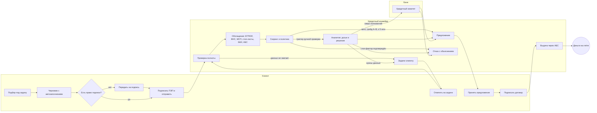

# 02. Модель кредитного процесса

Модель описывает, где начинается и заканчивается процесс, кто в нём участвует, какие этапы проходит заявка, какие данные
создаются и используются на каждом этапе и чем каждый этап заканчивается. Модель реализована в коде буквально:
статусы и переходы — `backend/app/domain/statuses.py` и `state_machine.py`, этапы конвейера — `services/pipeline.py`,
действия банка — `services/bank.py`. Диаграмма состояний генерируется из кода: [state-diagram.md](state-diagram.md).

## 1. Границы процесса

| | |
|---|---|
| **Начало** | У предпринимателя появилась потребность в деньгах, и он описывает задачу в кабинете (или видит предодобренное предложение) |
| **Успешный конец** | Деньги зачислены на расчётный счёт, кредит и график платежей отображаются в разделе «Кредиты» (`issued`) |
| **Другие завершения** | Отказ с объяснением (`declined`), отказ клиента от предложения (`client_declined`), отзыв заявки (`cancelled`), истечение срока (`expired`) |
| **В границах** | Подбор продукта, заявка с автозаполнением, роли внутри компании, подпись, автоматические проверки, обогащение из источников, скоринг, решение, ручное рассмотрение и комитет, запрос информации, предложение и контрпредложение, договор, выдача, уведомления |
| **За границами MVP** | Обслуживание кредита (платежи, досрочное погашение, реструктуризация), мониторинг ковенант, залоговая экспертиза и регистрация залога, взыскание, онбординг нового клиента (открытие счёта), квалифицированная ЭП |

## 2. Участники

| Участник | Роль в процессе | Реализация |
|---|---|---|
| Сотрудник компании без права подписи (бухгалтер) | Готовит заявку, загружает документы, отвечает на вопросы, передаёт на подпись | `company_members.role = accountant`, `can_sign = false` |
| Подписант (руководитель ООО, ИП, собственник) | Подписывает заявку и согласия, принимает предложение, подписывает договор | `can_sign = true`, `is_beneficiary` — поручитель |
| Кредитный конвейер (система) | Проверяет, обогащает, оценивает, решает в пределах автоматических полномочий, выдаёт | Воркеры `worker ×2`, очередь задач в PostgreSQL |
| Движок решения и скоринговая карта | Рекомендация, цена, посильная сумма, маршрут | `domain/decision`, `domain/scoring` |
| Кредитный аналитик / старший аналитик | Ручное рассмотрение в пределах лимита (15 / 30 млн ₽), запрос информации, эскалация | `bank_role = analyst / senior_analyst` |
| Риск-менеджер (кредитный комитет) | Решения сверх полномочий аналитиков и по грейду D | `bank_role = risk_manager` |
| Владелец продукта | Кредитная политика (версии), дашборд, аудит, мониторинг | `bank_role = admin` |
| Внешние системы | ЕГРЮЛ/ЕГРИП, ФНС, реестр МСП, стоп-листы, БКИ, АБС | Симулятор `mocks` (см. THIRD_PARTY_NOTICES) |

## 3. Этапы, данные и результаты

| # | Этап | Кто действует | Входные данные | Что происходит | Результат | Статус | Норматив |
|---|---|---|---|---|---|---|---|
| 0 | Подбор | Клиент | Задача: цель, сумма, срок, срочность, регулярность, залог; профиль компании; обороты в банке | Ранжирование продуктов с объяснением «почему подходит / что помешает», расчёт платежа; предодобренный лимит клиентам банка | Выбранный продукт и параметры | — | мгновенно |
| 1 | Подготовка заявки | Клиент (любой участник) | ЕГРЮЛ/ЕГРИП, профиль пользователя, учредители, обороты АБС | Черновик с автозаполнением, у каждого поля — источник; автосохранение; динамический чек-лист; разбор выписки 1С/CSV | Анкета и документы | `draft` | — |
| 2 | Передача на подпись | Бухгалтер → руководитель | Заполненная анкета | Проверка полноты, задача руководителю в кабинете | Заявка ждёт подписи | `pending_signature` | — |
| 3 | Подпись и отправка | Подписант | Анкета, согласия БКИ (заёмщик и поручитель), согласие на ПДн | ПЭП: пароль, хэш каждого документа, время, IP; задача конвейеру в той же транзакции | Подписанная заявка в очереди | `submitted` | 15 мин |
| 4 | Проверка полноты и корректности | Система | Анкета, чек-лист, документы, условия продукта | Валидация, сверка с чек-листом, период выписки, условия продукта | Переход к обогащению / задачи клиенту / отказ по условиям продукта | `data_check` | 15 мин |
| 4a | Уточнения | Клиент | Задачи (документ или вопрос) | Загрузка документов прямо в задачу, ответы, возврат в работу | Повторная проверка | `info_requested` | 5 дней (срок ответа 14 дней) |
| 5 | Обогащение | Система | ИНН, лица, согласия | ЕГРЮЛ, ФНС, реестр МСП, стоп-листы, БКИ компании и собственника, АБС; повторы и предохранитель; актуализация карточки | Нормализованные сведения с происхождением, журнал вызовов | `enrichment` | 30 мин |
| 6 | Скоринг и решение | Система | Признаки из источников и анкеты, политика (версия) | Скоринговая карта → грейд; политика: стоп-факторы, триггеры ручной проверки, цена, DSCR, контрпредложение, уровень полномочий | Рекомендация и маршрут: авто-предложение / авто-отказ / специалист | `scoring` | 15 мин |
| 7 | Ручное рассмотрение | Аналитик | Досье: источники, скоринг, рекомендация, расчёт посильности, документы, черновик заключения | Решение в пределах полномочий, запрос информации, перезапрос источников, эскалация | Решение или передача на комитет | `manual_review` | 8 ч |
| 7a | Кредитный комитет | Риск-менеджер | Досье и предложение аналитика | Одобрение (не ниже расчётной ставки), отказ, возврат аналитику | Решение | `committee_review` | 24 ч |
| 8 | Предложение | Клиент-подписант | Условия, изменения относительно запроса, график, ПСК | Принятие или отказ (без последствий) | Принятое предложение | `offer_issued` | срок предложения 10 дней |
| 9 | Подписание договора | Клиент-подписант | Договор по принятым условиям, договор поручительства | ПЭП договора и поручительства | Подписанный договор, задача выдачи | `offer_accepted` | 72 ч |
| 10 | Выдача | Система | Договор, реквизиты счёта | Идемпотентный вызов АБС, ссудный счёт, график | Кредит и график в кабинете | `disbursement` → `issued` | 1 ч |

Каждый этап записывает в журнал заявки событие (кто, когда, что), а клиенту — понятное уведомление в кабинете
(почта, мессенджеры и SMS не используются). Клиент видит шесть шагов маршрута и «чей ход»; банк — внутренний статус и норматив.

## 4. Дорожки (swimlanes)

## 5. Данные процесса

| Объект | Создаётся на этапе | Ключевые данные | Где хранится |
|---|---|---|---|
| Компания | Подключение по ИНН | Реквизиты, ОКВЭД, руководитель, учредители, МСП, клиент банка; снимок ЕГРЮЛ | `companies`, `company_members` |
| Заявка | 1 | Продукт, сумма, срок, цель, анкета, **источник каждого автозаполненного поля** | `applications.form`, `.prefill` |
| Документы и выписка | 1, 4a | Файл, хэш, тип; аналитика выписки (обороты, волатильность, платежи по долгам, исключения) | `documents`, `applications.statement` |
| Подписи | 3, 9 | Документ, SHA-256, подписант, время, IP, user-agent | `signatures` |
| Задачи | 4, 7 | Документ или вопрос, ответ, кто создал (система / аналитик) | `tasks` |
| Сведения источников | 5 | Ответы источников, статус каждого, нормализованные показатели | `applications.enrichment`, `integration_calls` |
| Проверки | 4, 6 | Код, результат, эффект (стоп / ручная), детали, источник | `check_results` |
| Скоринг | 6 | Балл, PD, грейд, вклад 10 факторов, версия модели | `scoring_results` |
| Решения | 6, 7 | Рекомендация движка и итоговое решение, уровень полномочий, причины, версия политики, снимок расчёта | `decisions` |
| Предложение | 6, 7 | Сумма, срок, ставка, платёж, переплата, эффективная ставка, условия, изменения | `offers` |
| Кредит | 10 | Номер договора, ссудный счёт, график, ссылка АБС | `loans` |
| Журнал | все | События заявки, аудит безопасности, уведомления | `application_events`, `audit_log`, `notifications` |

Модель данных целиком — [06-data-model](../06-data-model/er-diagram.md).

## 6. RACI

R — выполняет, A — отвечает за результат, C — консультирует, I — информируется.

| Этап | Клиент (сотрудник) | Клиент (подписант) | Конвейер | Аналитик | Комитет | Владелец продукта |
|---|---|---|---|---|---|---|
| Подбор и заявка | R | A | C (автозаполнение) | — | — | I (метрики) |
| Подпись и отправка | I | R/A | — | — | — | — |
| Проверка и обогащение | I | I | R/A | I | — | I |
| Скоринг и рекомендация | — | — | R | C | — | A (политика) |
| Решение в пределах авто-полномочий | I | I | R | — | — | A |
| Ручное решение | I | I | C | R/A | I | — |
| Решение сверх полномочий | I | I | C | R (подготовка) | A | — |
| Предложение и договор | C | R/A | — | I | — | — |
| Выдача | I | I | R/A | I | — | — |
| Изменение политики | — | — | — | — | C | R/A |

## 7. Исключения и альтернативные потоки

| Ситуация | Поведение | Где проверить |
|---|---|---|
| Не хватает данных или документов | Задачи клиенту прямо в заявке, статус «Нужны уточнения», после ответа — повторная проверка | S5 |
| Источник недоступен | Повторы с паузой; после исчерпания попыток — **ручная проверка с пометкой**, а не отказ; аналитик перезапрашивает источники | S6 |
| Данные анкеты расходятся с реестром | Карточка актуализируется по свежему ЕГРЮЛ, заявка уходит специалисту с описанием расхождения | S2 |
| Стоп-фактор подтверждён источником | Автоматический отказ с причинами простыми словами и планом действий | S4, S7 |
| Запрошенное непосильно | Контрпредложение: сначала увеличение срока, затем уменьшение суммы; объяснение изменений | S3 |
| Сумма выше полномочий | Аналитик не может одобрить (403), выносит на комитет | S2 |
| Решение вопреки рекомендации движка | Требуется обоснование ≥ 10 символов, фиксируется в журнале и аудите | тесты |
| Ставка ниже расчётной по политике | Отклоняется (`rate_below_floor`) | тесты |
| Параллельные изменения | Оптимистическая блокировка: 409 `stale_version`, решение по устаревшим данным невозможно | S2, тесты |
| Повторное нажатие «Подписать» / обрыв связи | `Idempotency-Key`: второе действие не выполняется, возвращается сохранённый ответ | S1 |
| Клиент не ответил за 14 дней / предложение истекло (10 дней) | Планировщик переводит заявку в «Срок истёк», клиенту — уведомление | тесты |
| Клиент передумал | Отзыв заявки до решения или отказ от предложения — без последствий | интерфейс |
| Сбой АБС при выдаче | Повторы задачи; выдача идемпотентна по ключу заявки; после исчерпания — передача в операционный отдел | конвейер |
| Падение воркера посреди задачи | Задача возвращается в очередь по истечении аренды и выполняется другим воркером | `worker/runner.py` |

## 8. Метрики процесса

Дашборд (`/bank/dashboard`) считает их по данным процесса:

- время до решения (медиана) — отдельно автоматических решений и решений специалиста;
- доля автоматических решений, уровень одобрения, доля контрпредложений;
- воронка: подано → решение → одобрено → предложение принято → выдано;
- нагрузка на специалистов и нарушения нормативов;
- ошибки внешних источников за 24 часа.

Продуктовые метрики и целевые значения — в [исследовании](../01-research/research.md#11-метрики-продукта).
