# Диаграмма состояний кредитной заявки

> Файл сгенерирован `backend/scripts/gen_docs.py` из `app/domain/state_machine.py` и `app/domain/statuses.py`.
> Любое изменение статуса в системе проходит только по этим переходам.

Статусов: **17**, переходов: **25**.

```mermaid
stateDiagram-v2
    direction LR
    [*] --> draft
    draft: Черновик
    pending_signature: Ожидает подписи клиента
    submitted: Подана
    data_check: Проверка полноты и корректности
    enrichment: Обогащение данными
    scoring: Скоринг и решение
    info_requested: Запрошена информация у клиента
    manual_review: Ручное рассмотрение (аналитик)
    committee_review: Кредитный комитет
    offer_issued: Предложение направлено клиенту
    offer_accepted: Предложение принято, подписание
    disbursement: Выдача средств
    issued: Кредит выдан
    declined: Отказ
    client_declined: Клиент отказался от предложения
    cancelled: Отозвана клиентом
    expired: Истёк срок
    draft --> pending_signature: send_for_signature
    pending_signature --> draft: return_to_draft
    draft --> submitted: submit
    pending_signature --> submitted: submit
    draft --> cancelled: cancel
    pending_signature --> cancelled: cancel
    info_requested --> cancelled: cancel
    manual_review --> cancelled: cancel
    committee_review --> cancelled: cancel
    submitted --> data_check: start_check
    data_check --> enrichment: start_enrichment
    enrichment --> scoring: start_scoring
    data_check --> info_requested: request_info
    scoring --> info_requested: request_info
    scoring --> offer_issued: auto_offer
    data_check --> declined: auto_decline
    enrichment --> declined: auto_decline
    scoring --> declined: auto_decline
    enrichment --> manual_review: refer
    scoring --> manual_review: refer
    info_requested --> data_check: client_answers
    manual_review --> offer_issued: analyst_offer
    manual_review --> declined: analyst_decline
    manual_review --> info_requested: analyst_request_info
    manual_review --> committee_review: escalate
    manual_review --> enrichment: rerun
    committee_review --> offer_issued: committee_offer
    committee_review --> declined: committee_decline
    committee_review --> manual_review: committee_return
    offer_issued --> offer_accepted: accept_offer
    offer_issued --> client_declined: decline_offer
    offer_accepted --> client_declined: decline_offer
    offer_accepted --> disbursement: sign_contract
    disbursement --> issued: disbursed
    info_requested --> expired: expire
    offer_issued --> expired: expire
    offer_accepted --> expired: expire
    issued --> [*]
    declined --> [*]
    client_declined --> [*]
    cancelled --> [*]
    expired --> [*]
```

## Статусы

| Код | Для банка | Для клиента | Шаг маршрута | Чей ход | Норматив, ч | Конечный |
|---|---|---|---|---|---|---|
| `draft` | Черновик | Черновик | application | клиент | — |  |
| `pending_signature` | Ожидает подписи клиента | Ждёт подписи руководителя | application | клиент | — |  |
| `submitted` | Подана | Заявка отправлена | check | система | 0.25 |  |
| `data_check` | Проверка полноты и корректности | Проверяем данные | check | система | 0.25 |  |
| `enrichment` | Обогащение данными | Запрашиваем сведения | assessment | система | 0.5 |  |
| `scoring` | Скоринг и решение | Оцениваем заявку | assessment | система | 0.25 |  |
| `info_requested` | Запрошена информация у клиента | Нужны уточнения | check | клиент | 120 |  |
| `manual_review` | Ручное рассмотрение (аналитик) | Рассматривает специалист | decision | банк | 8 |  |
| `committee_review` | Кредитный комитет | Рассматривает кредитный комитет | decision | банк | 24 |  |
| `offer_issued` | Предложение направлено клиенту | Предложение готово | decision | клиент | 240 |  |
| `offer_accepted` | Предложение принято, подписание | Подпишите договор | signing | клиент | 72 |  |
| `disbursement` | Выдача средств | Перечисляем деньги | disbursement | система | 1 |  |
| `issued` | Кредит выдан | Деньги на счёте | disbursement | — | — | да |
| `declined` | Отказ | Банк не может одобрить заявку | decision | — | — | да |
| `client_declined` | Клиент отказался от предложения | Вы отказались от предложения | decision | — | — | да |
| `cancelled` | Отозвана клиентом | Заявка отозвана | application | — | — | да |
| `expired` | Истёк срок | Срок истёк | decision | — | — | да |

## Переходы

| Переход | Из | В | Кто выполняет | Событие в журнале |
|---|---|---|---|---|
| `send_for_signature` | `draft` | `pending_signature` | клиент | Заявка передана на подпись руководителю |
| `return_to_draft` | `pending_signature` | `draft` | клиент | Заявка возвращена на доработку |
| `submit` | `draft`, `pending_signature` | `submitted` | подписант клиента | Заявка подписана и отправлена в банк |
| `cancel` | `draft`, `pending_signature`, `info_requested`, `manual_review`, `committee_review` | `cancelled` | подписант клиента | Заявка отозвана клиентом |
| `start_check` | `submitted` | `data_check` | система | Начата проверка полноты и корректности данных |
| `start_enrichment` | `data_check` | `enrichment` | система | Данные проверены, запрошены сведения из внешних источников |
| `start_scoring` | `enrichment` | `scoring` | система | Сведения получены, выполняется оценка |
| `request_info` | `data_check`, `scoring` | `info_requested` | система | Запрошена дополнительная информация |
| `auto_offer` | `scoring` | `offer_issued` | система | Автоматическое решение: предложение сформировано |
| `auto_decline` | `data_check`, `enrichment`, `scoring` | `declined` | система | Автоматическое решение: отказ |
| `refer` | `enrichment`, `scoring` | `manual_review` | система | Заявка передана на рассмотрение специалисту |
| `client_answers` | `info_requested` | `data_check` | клиент | Клиент предоставил информацию, заявка возвращена в работу |
| `analyst_offer` | `manual_review` | `offer_issued` | аналитик | Аналитик одобрил заявку |
| `analyst_decline` | `manual_review` | `declined` | аналитик | Аналитик отказал в выдаче |
| `analyst_request_info` | `manual_review` | `info_requested` | аналитик | Аналитик запросил информацию у клиента |
| `escalate` | `manual_review` | `committee_review` | аналитик | Заявка вынесена на кредитный комитет |
| `rerun` | `manual_review` | `enrichment` | аналитик | Аналитик перезапросил сведения из внешних источников |
| `committee_offer` | `committee_review` | `offer_issued` | комитет | Кредитный комитет одобрил заявку |
| `committee_decline` | `committee_review` | `declined` | комитет | Кредитный комитет отказал в выдаче |
| `committee_return` | `committee_review` | `manual_review` | комитет | Комитет вернул заявку аналитику на доработку |
| `accept_offer` | `offer_issued` | `offer_accepted` | подписант клиента | Клиент принял предложение |
| `decline_offer` | `offer_issued`, `offer_accepted` | `client_declined` | подписант клиента | Клиент отказался от предложения |
| `sign_contract` | `offer_accepted` | `disbursement` | подписант клиента | Кредитный договор подписан |
| `disbursed` | `disbursement` | `issued` | система | Кредит выдан, деньги зачислены на счёт |
| `expire` | `info_requested`, `offer_issued`, `offer_accepted` | `expired` | система | Истёк срок ожидания ответа клиента |
