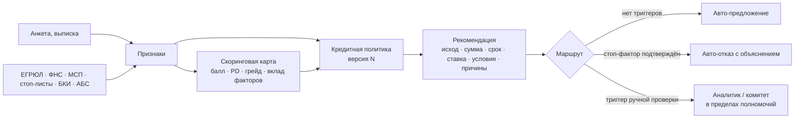

# 03. Модель принятия кредитного решения

Модель разделяет две разные вещи, как и предлагается в кейсе: **скоринг** оценивает риск заёмщика (балл, вероятность
дефолта, грейд), а **кредитная политика** превращает оценку и сведения в решение по конкретной заявке: отказ по
стоп-фактору, ручная проверка, цена, посильная сумма, контрпредложение, уровень полномочий. Поэтому один и тот же
грейд даёт разные условия для разных продуктов.

Код: скоринг — `backend/app/domain/scoring`, политика и движок — `backend/app/domain/decision`, применение в
конвейере — `services/pipeline.py` (`stage_score`), ручные решения — `services/bank.py` (`decide`).
Движок — чистая функция без БД и сети: на одинаковых входах даёт одинаковый результат, покрыт модульными тестами.

## 1. Принципы

1. **Сначала данные, потом вопросы.** Выручка берётся из подтверждённого источника по приоритету: обороты в банке →
   выписка → отчётность ФНС → анкета (последний вариант всегда ведёт к ручной проверке).
2. **Недоступность источника — не повод для отказа.** Если источник не ответил после повторов, заявка идёт к специалисту
   с пометкой, а фактор оценивается консервативно.
3. **Контрпредложение вместо отказа**, если бизнес может обслуживать меньший платёж.
4. **Каждое решение объяснимо и воспроизводимо**: причины для клиента простыми словами, вклад факторов для аналитика,
   версии политики и модели и полный снимок расчёта — в записи решения.
5. **Люди решают в пределах полномочий**; расхождение с рекомендацией требует письменного обоснования.

## 2. Данные и признаки

| Признак скоринга | Источник | Комментарий |
|---|---|---|
| Срок ведения бизнеса | ЕГРЮЛ/ЕГРИП | от даты регистрации |
| Годовая выручка | ФНС → обороты/выписка ×12 → анкета | |
| Стабильность оборотов (коэф. вариации) | АБС или выписка | нет данных — отдельный интервал |
| Долговая нагрузка | БКИ (действующие кредиты) + платёж по новому кредиту / выручка | новый платёж — по оценочной ставке грейда B |
| Просрочки компании за 24 мес. | БКИ | для ИП компания и собственник — одно лицо |
| Просрочки собственника за 24 мес. | БКИ (по согласию поручителя) | |
| Запросы кредитной истории за 30 дней | БКИ | |
| Налоговая задолженность / месячная выручка | ФНС | |
| Отраслевой риск | ОКВЭД → справочник отраслей | |
| История обслуживания в банке | АБС | |

Для политики дополнительно используются: статус в ЕГРЮЛ, совпадения в стоп-листах, дисквалификация, массовый адрес,
блокировки счетов, реестр МСП, сверка анкеты с реестром (руководитель), расхождение заявленной и подтверждённой
выручки, залог.

## 3. Скоринговая карта

Классическая карта: интервалы признаков → WOE → логистическая регрессия → баллы. Масштаб: 600 баллов при шансах
30:1, 40 баллов удваивают шансы (PDO). Построение и валидация — `ml/build_scorecard.py`, отчёт —
[scorecard-validation.md](scorecard-validation.md): Gini 0,72 на тесте и 0,74 на out-of-time, KS 0,57, PSI баллов 0,03,
калибровка по грейдам в пределах доверительных интервалов. Данные синтетические, поэтому метрики показывают
методологию, а не реальный риск.

| Грейд | PD | Минимальный балл | Что значит для решения (политика v1) |
|---|---|---|---|
| A | < 2% | 628 | авто-одобрение, базовая ставка |
| B | 2–4% | 587 | авто-одобрение, +1,5 п. п. |
| C | 4–8% | 545 | ручная проверка, +3 п. п. |
| D | 8–15% | 504 | только кредитный комитет, +5 п. п. |
| E | ≥ 15% | — | отказ |

Карта хранится как версионированный JSON (`scorecard.json`), сервис только применяет её — это быстро, детерминированно и
объяснимо: для каждого фактора видно значение, интервал, полученные и «потерянные» баллы. Отсутствующие данные
оцениваются консервативно (худший интервал) и помечаются — такая заявка идёт на ручную проверку.

## 4. Кредитная политика

Параметры — `domain/decision/policy.py` (`DEFAULT_POLICY`); часть меняется владельцем продукта из интерфейса, каждое
изменение создаёт новую версию с обоснованием (`credit_policies`) и записью в аудите.

### Стоп-факторы (отказ, если подтверждены источником)

| Код | Условие | Источник |
|---|---|---|
| `STOP_COMPANY_STATUS` | Компания не действующая (ликвидация, реорганизация, банкротство) | ЕГРЮЛ/ЕГРИП |
| `STOP_AML` | Совпадение в перечнях и стоп-листах | Стоп-листы |
| `STOP_DISQUALIFIED` | Руководитель дисквалифицирован | ФНС |
| `OVERDUE_COMPANY` / `OVERDUE_OWNER` | Просрочка ≥ 90 дней за 24 мес. | БКИ |
| `TAX_ARREARS` | Налоговый долг ≥ 300 тыс. ₽ и ≥ 10% месячной выручки | ФНС |
| `STOP_BUSINESS_AGE` | Срок бизнеса меньше требования продукта | ЕГРЮЛ |
| `GOV_ELIGIBILITY` | Льготная программа: не приоритетная отрасль или нет в реестре МСП | Реестр МСП |
| `SCORE_GRADE` | Грейд E (как отдельная причина — только если нет других стоп-факторов) | Скоринг |
| `LOW_AFFORDABILITY` | Посильная сумма меньше минимума продукта и 30% запроса | Расчёт DSCR |

### Триггеры ручной проверки

Источник не ответил (ЕГРЮЛ, БКИ компании или собственника); расхождение анкеты с реестром; массовый адрес;
блокировки счетов; просрочка 30–89 дней; расхождение заявленной и подтверждённой выручки > 40%; выручка только со слов
клиента; грейд C или D; неполные данные скоринга; сумма выше лимита автоматического решения (5 млн ₽); продукт с
решением специалиста (инвестиционный, кредитная линия, льготный); повторное рассмотрение после ручной проверки.

## 5. Цена, посильность и контрпредложение

**Ставка** = ключевая ставка + спред продукта + надбавка грейда − 0,5 п. п. клиенту банка от 12 месяцев − 1 п. п. при
залоге. Льготный продукт — ставка равна ключевой. Аналитик и комитет не могут назначить ставку ниже расчётной.

| Пример | Расчёт | Ставка |
|---|---|---|
| S1, экспресс-кредит, грейд A, клиент банка | 14 + 8 + 0 − 0,5 | **21,5%** |
| S2, инвестиционный кредит, грейд B, клиент банка, залог | 14 + 4,5 + 1,5 − 0,5 − 1 | **18,5%** |

**Посильность.** Операционный денежный поток = подтверждённая выручка × отраслевая маржинальность × коэффициент
политики. Посильный новый платёж = поток / минимальный DSCR (1,3) − текущие платежи по кредитам. Максимальная сумма —
минимум из ограничений:

| Ограничение | Расчёт |
|---|---|
| Посильность | сумма, для которой аннуитет = посильный платёж (для лимитов — проценты + 1/срок основного долга) |
| Лимит продукта | максимальная сумма продукта |
| Обороты | мультипликатор продукта × месячная выручка (для беззалоговых) |
| Залог | стоимость × дисконт по виду залога (недвижимость 0,7, транспорт 0,6, оборудование 0,5…) |
| Без залога | порог продукта, с которого нужен залог |

Пример S1: 1 350 000 ₽ × 12% = 162 000 ₽ потока; / 1,3 = 124 615 ₽; − 21 000 ₽ лизинга = 103 615 ₽ посильного
платежа; запрошенный платёж 77 447 ₽ — проходит, DSCR при предложении ≈ 1,64.

**Контрпредложение**, если запрос выше максимума: (1) увеличить срок с шагом 6 месяцев до максимума продукта — если
этого достаточно, сумма не меняется; (2) иначе — уменьшить сумму до посильной (выбирая срок, дающий большую сумму),
если она не меньше минимума продукта и 30% запроса; при ограничении «без залога» клиенту подсказывается, что большую
сумму можно получить под залог. Клиент видит, что именно изменилось и почему.

## 6. Маршрут и полномочия

| Уровень | Когда | Кто решает |
|---|---|---|
| Автоматически | Нет триггеров ручной проверки, грейд A–B, сумма ≤ 5 млн ₽; или подтверждённый стоп-фактор | Движок |
| Аналитик | Сумма ≤ 15 млн ₽ | `analyst` (лимит в профиле) |
| Старший аналитик | Сумма ≤ 30 млн ₽ | `senior_analyst` |
| Кредитный комитет | Сумма > 30 млн ₽ или грейд D | `risk_manager` |

Аналитик может одобрить (сумма не больше запрошенной, ставка не ниже расчётной), отказать (с кодами причин — клиент
увидит их формулировки), запросить документы и пояснения, перезапросить источники, вынести на комитет. Решение вопреки
рекомендации движка требует обоснования. Каждое решение фиксирует уровень, автора, версию политики и модели, снимок
рекомендации; изменение заявки параллельно с решением отсекается (`version`, HTTP 409).

## 7. Объяснимость, версии и ИИ

- **Клиенту**: при отказе — причины простыми словами, факторы, сильнее всего снизившие оценку, сильные стороны и
  план из 3–4 шагов с ориентиром для повторной заявки; при контрпредложении — список изменений и объяснение DSCR.
- **Аналитику**: вклад каждого фактора, все проверки с источниками, расчёт посильности и ограничений, сведения
  источников с журналом вызовов, черновик кредитного заключения.
- **Аудит и воспроизводимость**: `decisions.snapshot` хранит полную рекомендацию; `policy_version` и `model_version`
  позволяют пересчитать решение.
- **Где ИИ используется**: помощник клиента (поиск по базе знаний + данные заявки, RAG) и черновик заключения
  аналитика. Факты берутся только из данных, LLM с открытыми весами (Qwen2.5 1.5B через Ollama) лишь формулирует текст;
  без неё работает детерминированный режим.
- **Где ИИ сознательно не используется**: само кредитное решение. Оно должно быть объяснимым, стабильным и
  проверяемым — это задача прозрачной карты и правил политики.

## 8. Ограничения и путь в промышленную эксплуатацию

| Сейчас (прототип) | В промышленной версии |
|---|---|
| Карта обучена на синтетике | Обучение на исторических данных банка, валидация независимым подразделением, мониторинг PSI/Gini и калибровки, плановая перекалибровка |
| Отраслевая маржинальность — справочник | Финансовая модель по отчётности и выпискам, отраслевые бенчмарки |
| Простые правила залога | Залоговая экспертиза, мониторинг залога, LTV по оценке |
| Политика — JSON-параметры | Те же параметры через BRMS/правила с ролевым согласованием изменений (четыре глаза) |
| Одна ставка по грейду | Риск-ориентированное ценообразование с учётом стоимости фондирования и капитала |
| Решение по заявке | Лимитное решение на клиента/группу связанных лиц, агрегированный риск |
| ПЭП в кабинете | УКЭП/МЧД для договоров, проверка полномочий через ЕСИА |
