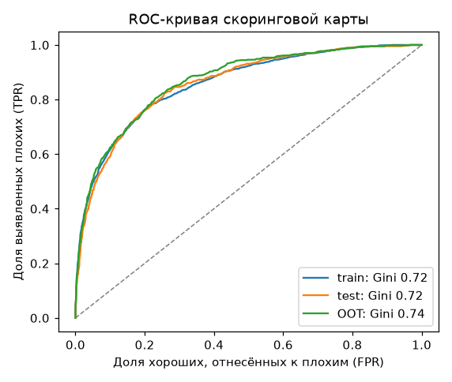
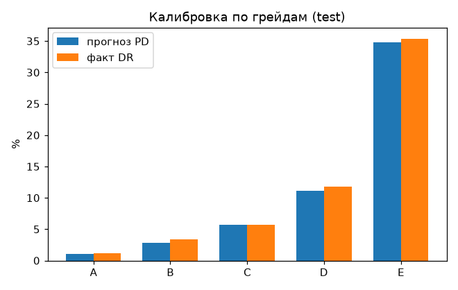
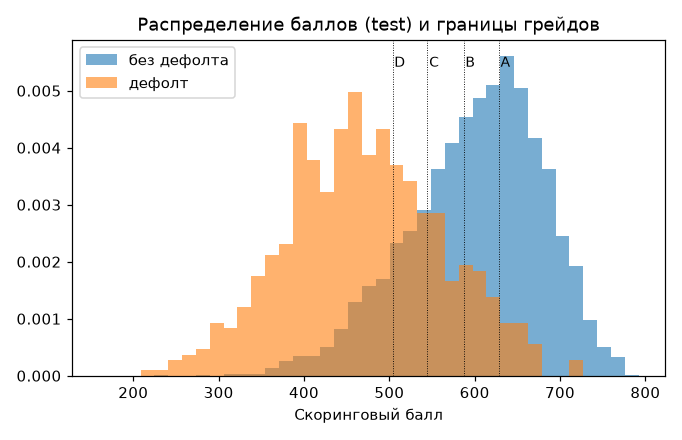

# Отчёт о построении и валидации скоринговой карты

> Файл сгенерирован скриптом `ml/build_scorecard.py` (seed фиксирован, результат воспроизводим). Данные синтетические: отчёт демонстрирует методологию проверки модели, а не реальный кредитный риск.

Версия модели: **sme-scorecard 1.0.0**. Целевое событие: Дефолт 90+ дней в течение 12 месяцев после выдачи.

## Выборки

| Выборка | Наблюдений | Доля дефолтов |
|---|---|---|
| Обучающая (train) | 16800 | 9,3% |
| Тестовая (test) | 7200 | 9,3% |
| Out-of-time (OOT, с дрейфом: выше нагрузка, больше молодых компаний) | 6000 | 10,8% |

## Дискриминирующая способность

| Метрика | train | test | OOT | Ориентир |
|---|---|---|---|---|
| Gini | 0,716 | 0,718 | 0,737 | > 0,40 приемлемо, > 0,60 хорошо |
| KS | — | 0,565 | 0,573 | > 0,30 |

## Стабильность (PSI)

PSI распределения баллов: test — **0,001**, OOT — **0,032** (< 0,10 — стабильно, 0,10–0,25 — умеренный сдвиг, требует наблюдения, > 0,25 — значимый сдвиг, нужна перекалибровка).

| Признак | PSI (OOT к train) |
|---|---|
| Срок ведения бизнеса | 0,021 |
| Годовая выручка | 0,001 |
| Стабильность оборотов | 0,001 |
| Долговая нагрузка | 0,109 |
| Просрочки компании за 24 мес. | 0,001 |
| Просрочки собственника за 24 мес. | 0,000 |
| Запросы кредитной истории за 30 дней | 0,091 |
| Налоговая задолженность | 0,001 |
| Отраслевой риск (ОКВЭД) | 0,001 |
| История обслуживания в банке | 0,008 |

## Калибровка по грейдам

**TEST**

| Грейд | Наблюдений | Доля | Прогноз PD | Факт DR | p-value биномиального теста |
|---|---|---|---|---|---|
| A | 2689 | 37,4% | 1,06% | 1,15% | 0,637 |
| B | 1328 | 18,4% | 2,84% | 3,39% | 0,247 |
| C | 1166 | 16,2% | 5,65% | 5,66% | 0,949 |
| D | 790 | 11,0% | 11,15% | 11,77% | 0,572 |
| E | 1227 | 17,0% | 34,85% | 35,37% | 0,697 |

**OOT**

| Грейд | Наблюдений | Доля | Прогноз PD | Факт DR | p-value биномиального теста |
|---|---|---|---|---|---|
| A | 1755 | 29,2% | 1,10% | 1,08% | 1,000 |
| B | 1116 | 18,6% | 2,88% | 1,61% | 0,009 |
| C | 1057 | 17,6% | 5,66% | 5,77% | 0,842 |
| D | 785 | 13,1% | 11,01% | 11,72% | 0,530 |
| E | 1287 | 21,4% | 37,30% | 35,51% | 0,195 |

## Информационная ценность признаков (IV)

| Признак | Источник | IV | Коэффициент β |
|---|---|---|---|
| Просрочки компании за 24 мес. | БКИ | 0,965 | -0,705 |
| Просрочки собственника за 24 мес. | БКИ (поручитель) | 0,814 | -0,589 |
| Стабильность оборотов | Обороты по расчётному счёту (АБС / выписка) | 0,359 | -0,626 |
| Запросы кредитной истории за 30 дней | БКИ | 0,332 | -0,534 |
| Долговая нагрузка | БКИ + параметры заявки | 0,294 | -0,733 |
| Годовая выручка | ФНС «Прозрачный бизнес» / обороты по счёту | 0,241 | -0,643 |
| Налоговая задолженность | ФНС «Прозрачный бизнес» | 0,211 | -0,739 |
| Срок ведения бизнеса | ЕГРЮЛ / ЕГРИП | 0,121 | -0,926 |
| История обслуживания в банке | АБС банка | 0,066 | -0,571 |
| Отраслевой риск (ОКВЭД) | ЕГРЮЛ / ЕГРИП | 0,047 | -1,417 |

IV: < 0,02 — бесполезный, 0,02–0,1 — слабый, 0,1–0,3 — средний, > 0,3 — сильный признак.

## Баллы скоринговой карты

Шкала: 600 баллов соответствуют шансам 30:1 (good:bad), каждые 40 баллов удваивают шансы.

**Срок ведения бизнеса** (ЕГРЮЛ / ЕГРИП)

| Интервал | Баллы | Доля дефолтов в интервале | Доля выборки |
|---|---|---|---|
| менее 6 мес. | 11 | 18,5% | 2,8% |
| 6–12 мес. | 24 | 15,2% | 7,6% |
| 1–2 года | 38 | 12,0% | 19,7% |
| 2–4 года | 55 | 9,0% | 21,4% |
| 4–8 лет | 72 | 6,8% | 29,2% |
| более 8 лет | 72 | 6,8% | 19,3% |

**Годовая выручка** (ФНС «Прозрачный бизнес» / обороты по счёту)

| Интервал | Баллы | Доля дефолтов в интервале | Доля выборки |
|---|---|---|---|
| до 5 млн ₽ | 14 | 23,3% | 4,5% |
| 5–15 млн ₽ | 39 | 13,4% | 20,6% |
| 15–60 млн ₽ | 56 | 8,9% | 48,5% |
| 60–200 млн ₽ | 81 | 4,7% | 22,4% |
| более 200 млн ₽ | 93 | 3,3% | 4,1% |

**Стабильность оборотов** (Обороты по расчётному счёту (АБС / выписка))

| Интервал | Баллы | Доля дефолтов в интервале | Доля выборки |
|---|---|---|---|
| стабильные | 93 | 3,4% | 27,7% |
| умеренные колебания | 58 | 8,5% | 37,4% |
| заметные колебания | 35 | 14,6% | 24,9% |
| сильные колебания | 19 | 21,0% | 4,8% |
| нет данных об оборотах | 48 | 10,7% | 5,1% |

**Долговая нагрузка** (БКИ + параметры заявки)

| Интервал | Баллы | Доля дефолтов в интервале | Доля выборки |
|---|---|---|---|
| до 5% выручки | 83 | 4,8% | 21,3% |
| 5–10% выручки | 69 | 6,7% | 32,2% |
| 10–20% выручки | 48 | 10,5% | 34,6% |
| 20–30% выручки | 23 | 17,5% | 9,3% |
| более 30% выручки | -10 | 31,8% | 2,6% |

**Просрочки компании за 24 мес.** (БКИ)

| Интервал | Баллы | Доля дефолтов в интервале | Доля выборки |
|---|---|---|---|
| нет просрочек | 88 | 4,3% | 69,7% |
| до 30 дней | 38 | 13,2% | 18,9% |
| 30–89 дней | 4 | 25,7% | 7,7% |
| 90 дней и более | -39 | 50,0% | 3,7% |

**Просрочки собственника за 24 мес.** (БКИ (поручитель))

| Интервал | Баллы | Доля дефолтов в интервале | Доля выборки |
|---|---|---|---|
| нет просрочек | 77 | 4,9% | 72,6% |
| до 30 дней | 39 | 13,7% | 18,3% |
| 30–89 дней | 9 | 27,5% | 6,1% |
| 90 дней и более | -25 | 51,3% | 3,0% |

**Запросы кредитной истории за 30 дней** (БКИ)

| Интервал | Баллы | Доля дефолтов в интервале | Доля выборки |
|---|---|---|---|
| 0–1 | 70 | 5,7% | 59,3% |
| 2–3 | 44 | 12,5% | 32,0% |
| 4–6 | 25 | 20,9% | 8,3% |
| 7 и более | -17 | 50,7% | 0,4% |

**Налоговая задолженность** (ФНС «Прозрачный бизнес»)

| Интервал | Баллы | Доля дефолтов в интервале | Доля выборки |
|---|---|---|---|
| нет задолженности | 64 | 7,5% | 86,7% |
| до 10% мес. выручки | 15 | 20,2% | 9,5% |
| более 10% мес. выручки | 10 | 22,1% | 3,7% |

**Отраслевой риск (ОКВЭД)** (ЕГРЮЛ / ЕГРИП)

| Интервал | Баллы | Доля дефолтов в интервале | Доля выборки |
|---|---|---|---|
| низкий | 78 | 7,1% | 29,9% |
| средний | 55 | 9,2% | 45,2% |
| повышенный | 30 | 12,1% | 24,9% |

**История обслуживания в банке** (АБС банка)

| Интервал | Баллы | Доля дефолтов в интервале | Доля выборки |
|---|---|---|---|
| не клиент банка | 49 | 10,5% | 45,1% |
| до 1 года | 43 | 12,5% | 9,3% |
| 1–3 года | 54 | 9,1% | 21,0% |
| более 3 лет | 69 | 6,0% | 24,7% |

## Грейды

| Грейд | Описание | PD | Минимальный балл |
|---|---|---|---|
| A | Минимальный риск | 0%–2% | 628 |
| B | Низкий риск | 2%–4% | 587 |
| C | Умеренный риск | 4%–8% | 545 |
| D | Повышенный риск | 8%–15% | 504 |
| E | Высокий риск | 15%–100% | — |
