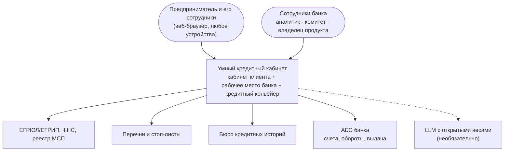
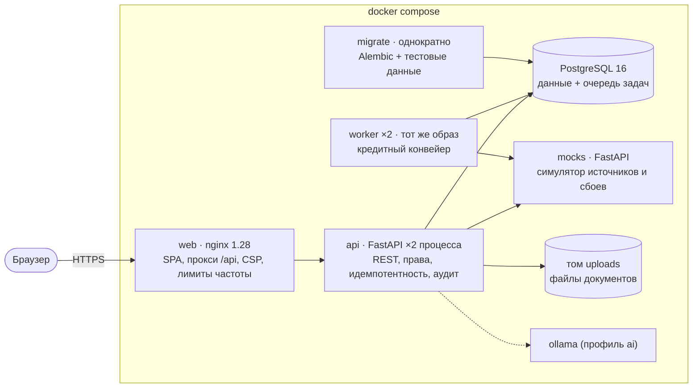

# 04. Архитектура

## 1. Контекст (C4, уровень 1)



Все внешние системы в прототипе заменены симулятором с теми же смысловыми контрактами (`mocks/`), поэтому стенд
автономен. Каналы уведомлений — только внутри кабинета.

## 2. Контейнеры (C4, уровень 2)



| Контейнер | Ответственность | Масштабирование |
|---|---|---|
| `web` | Раздаёт собранный SPA, проксирует `/api`, заголовки безопасности, лимит частоты на вход и API | горизонтально, без состояния |
| `api` | Аутентификация и авторизация, сценарии клиента и банка, валидация, идемпотентность, аудит, метрики | горизонтально, без состояния (кроме файлов → S3 в проде) |
| `worker` | Этапы конвейера из очереди: проверка, обогащение, скоринг и решение, выдача, обслуживание сроков | горизонтально: `FOR UPDATE SKIP LOCKED` |
| `db` | Единственный источник истины: заявки, решения, журналы, очередь задач | вертикально; реплики чтения для дашбордов |
| `mocks` | Симулятор внешних систем с задержками и управляемыми сбоями | — |

## 3. Компоненты бэкенда

```
backend/app
├── api/            HTTP-слой: auth, client, bank, system (+ deps: БД, пользователь, идемпотентность)
├── services/       сценарии: applications, documents, offers, bank, pipeline, companies, feed, assistant, memo,
│                   transitions (единая точка смены статуса), jobs (outbox), access (объектная авторизация), audit
├── domain/         чистая логика без БД: статусы и машина состояний, продукты и подбор, калькулятор, чек-лист,
│                   разбор выписки, скоринг, политика и движок решения, лента, база знаний, валидация реквизитов
├── integrations/   отказоустойчивый клиент источников: таймауты, повторы, предохранитель, журнал вызовов
├── worker/         исполнитель очереди: аренда, повторы, dead letter, обслуживание сроков
├── seed/           синтетические данные и история заявок через настоящий конвейер
└── models.py       24 таблицы (SQLAlchemy 2), миграции — alembic/
```

Зависимости направлены внутрь: `api → services → domain`; домен не знает о БД и HTTP — поэтому скоринг, политика,
калькулятор и машина состояний покрыты быстрыми модульными тестами.

## 4. Последовательность обработки заявки

```mermaid
sequenceDiagram
    autonumber
    actor C as Клиент
    participant W as web/nginx
    participant A as api
    participant D as PostgreSQL
    participant K as worker
    participant X as Источники (mocks)
    C->>W: POST /applications/{id}/submit (пароль, согласия, Idempotency-Key)
    W->>A: proxy + X-Request-ID
    A->>D: BEGIN: подписи (хэши) + статус submitted + задача pipeline.check (outbox) + ключ идемпотентности; COMMIT
    A-->>C: 200 заявка (статус «Заявка отправлена»)
    loop каждые 1–4 с
      C->>A: GET /applications/{id}
    end
    K->>D: SELECT … FOR UPDATE SKIP LOCKED (pipeline.check)
    K->>D: data_check → проверки → enrichment + задача pipeline.enrich
    K->>X: ЕГРЮЛ, ФНС, МСП, стоп-листы, БКИ (с согласием), АБС
    alt источник не отвечает
      K->>D: прогресс сохранён, задача на повтор с паузой (до 4 попыток)
      Note over K,D: после исчерпания — источник «недоступен» → ручная проверка
    end
    K->>D: scoring → скоринг + политика → решение (версии политики и модели)
    alt авто-предложение
      K->>D: offer_issued + предложение + уведомление
    else стоп-фактор
      K->>D: declined + причины + уведомление
    else ручная проверка
      K->>D: manual_review (уровень полномочий, основания, норматив)
    end
    C->>A: принять предложение, подписать договор (идемпотентно)
    K->>X: POST /abs/v1/loans (Idempotency-Key = заявка)
    K->>D: issued + кредит и график
```

## 5. Ключевые архитектурные решения (ADR)

| # | Решение | Почему | Цена решения |
|---|---|---|---|
| 1 | Модульный монолит (API + воркеры одного образа) вместо микросервисов | Одна команда, одна транзакционная граница, проще проверить и развернуть; модули разделены так, что выделяются в сервисы при росте | При росте нагрузки на разные части их придётся выделять |
| 2 | Очередь задач в PostgreSQL (`SKIP LOCKED`) + transactional outbox | Задача создаётся атомарно со сменой статуса — нельзя «потерять» заявку или выполнить этап раньше коммита; не нужен отдельный брокер | Пропускная способность ниже Kafka/RabbitMQ — для кредитного потока МСБ достаточно с большим запасом |
| 3 | Машина состояний — единственный путь смены статуса | Нельзя попасть в неразрешённый статус; журнал событий и уведомления — в одной точке | Новые ветки процесса требуют явного описания перехода |
| 4 | Скоринг отделён от политики; карта — JSON-артефакт | Модель строится и валидируется офлайн, в сервисе только применяется; политика меняется без релиза | Переобучение — отдельный процесс |
| 5 | Политика хранится версиями, решение — со снимком | Воспроизводимость и аудит решения | Рост объёма данных решений |
| 6 | Недоступный источник → ручная проверка, а не отказ | Сбой интеграции не должен становиться отказом клиенту | Нагрузка на аналитиков при длительных сбоях (видна на дашборде) |
| 7 | Идемпотентность опасных операций и оптимистическая блокировка | Двойной клик, повтор после обрыва и параллельная работа не приводят к двойной подписи/выдаче или решению по устаревшим данным | Клиент должен передавать ключ (интерфейс делает это сам) |
| 8 | Опрос статуса вместо WebSocket/SSE | Проще, работает через любые прокси, нагрузка мала (интервал зависит от статуса) | Задержка обновления до 1–4 с |
| 9 | LLM только с открытыми весами и только для текста | Условие кейса; решение остаётся объяснимым | Качество текста ниже крупных моделей — факты всё равно из данных |

## 6. Безопасность

- **Аутентификация**: пароли — Argon2id; доступ к API — JWT (HS256, срок жизни 8 ч). В промышленной версии — Альфа-ID
  для клиентов и корпоративный SSO (OIDC) для сотрудников; API уже работает по Bearer-токену. При `APP_ENV=production`
  запуск со стандартным `JWT_SECRET` запрещён.
- **Авторизация** на уровне объектов: клиент видит только заявки компаний, в которых состоит (чужая заявка → 404, чтобы
  не раскрывать существование); действия с правом подписи — только подписанту; сотрудники банка — по ролям и лимитам
  полномочий; политика — только владельцу продукта и риск-менеджеру.
- **Подпись**: повторный ввод пароля, SHA-256 содержимого каждого подписываемого документа, время, IP, user-agent;
  согласия БКИ — отдельные документы, без согласия симулятор БКИ отвечает отказом (как реальное бюро).
- **Аудит**: входы и неудачные попытки, просмотры досье, решения, изменения политики, скачивание документов, подписи —
  с IP и `request_id` (`/bank/audit`).
- **Веб**: CSP без внешних скриптов, `X-Frame-Options: DENY`, `nosniff`, Referrer-Policy, Permissions-Policy; шрифты
  и иконки — в сборке, без CDN; договор показывается в изолированном `iframe sandbox`.
- **Перебор паролей**: лимит nginx (10 запросов в минуту на `/auth/login`) и лимит в приложении (10 неудач на e-mail за 5 мин).
- **Файлы**: белый список расширений, проверка сигнатуры содержимого, лимит размера, безопасные имена, путь вне каталога
  хранения невозможен; выдача только после проверки прав. В проде — S3 с шифрованием и антивирусной проверкой.
- **Цепочка поставки**: Python-зависимости с хэшами (`--require-hashes`), npm — по `package-lock.json` (`npm ci`),
  версии базовых образов зафиксированы; контейнеры запускаются не от root.
- **Данные**: все синтетические; персональные данные в журналах не пишутся (только идентификаторы); в проде — маскирование
  в журналах, шифрование на уровне хранилища, разграничение доступа к БД.
- **Ошибки** — единый формат RFC 7807 без внутренних деталей; детали — в журнале по `request_id`.

## 7. Надёжность и отказоустойчивость

| Механизм | Где |
|---|---|
| Таймауты, повторы с экспоненциальной паузой и джиттером, без повторов на 4xx | `integrations/client.py` |
| Предохранитель (circuit breaker) на каждый источник | там же |
| Повтор этапа конвейера с сохранением прогресса (уже полученные источники не запрашиваются заново) | `pipeline.stage_enrich` |
| Деградация: после исчерпания попыток — ручная проверка | `pipeline` + `decision.policy_checks` |
| Dead letter: неуспешные задачи видны в мониторинге, повтор по кнопке | `/bank/system` |
| Аренда задач: задачи упавшего воркера возвращаются в очередь | `worker/runner.maintenance` |
| Идемпотентные этапы (повтор задачи безопасен) и идемпотентная выдача в АБС | `pipeline`, `mocks /abs/v1/loans` |
| Плавная остановка воркера по SIGTERM | `worker/__main__.py` |
| Проверки здоровья: `live`, `ready` (БД; источники — информативно) | `api/system.py`, healthcheck в Dockerfile |
| Сбои по требованию: `POST :8081/admin/faults` (outage, error, timeout, slow), `MOCK_ERROR_RATE` | симулятор |

## 8. Масштабирование и производительность

- `api` и `worker` не хранят состояние (кроме файлов) — масштабируются репликами; в compose запущено 2 воркера,
  и задачи распределяются между ними без дублей.
- Индексы под рабочие запросы: очередь задач (`status, run_after, priority`), очередь банка (`status, sla_due_at`),
  заявки компании, события заявки.
- Тяжёлые операции (источники, скоринг) вынесены из HTTP-запроса в конвейер — время ответа API не зависит от источников.
- Предодобренные предложения кешируются на 60 с; лента ранжируется в памяти по небольшому корпусу.
- Путь роста: реплики чтения для дашбордов и отчётов, объектное хранилище для файлов, выделение конвейера и интеграций
  в отдельные сервисы с брокером сообщений, когда поток заявок вырастет на порядки.

## 9. Наблюдаемость и сопровождение

- **Журналы** — JSON в stdout у всех сервисов, с `request_id` (сквозной от nginx через API и воркер до симулятора),
  `user_id` и `job`.
- **Метрики Prometheus**: HTTP (количество, длительность по маршрутам), задачи конвейера (результат, длительность),
  вызовы источников (статус, длительность), переходы статусов, решения по исходу и уровню. API — `/metrics`
  (наружу через nginx не публикуется), воркер — порт 9100.
- **Бизнес-мониторинг**: дашборд процесса, мониторинг очереди задач, журнал вызовов источников по каждой заявке.
- **Сопровождение**: миграции Alembic при старте, конфигурация через переменные окружения (12-factor), версии политики
  без релиза, генерация документации из кода и проверка её актуальности в CI.

## 10. Развёртывание

Одна команда — `docker compose up -d --build` (порядок запуска обеспечен зависимостями и healthcheck: db → mocks →
migrate → api, worker → web). Для публичного сервера — см. [демонстрация](../08-demo/demo-script.md#публикация-на-внешнем-сервере).

## 11. Путь развития

Онбординг нового клиента с открытием счёта; сопровождение кредита (платежи, досрочное погашение, ковенанты);
лимит на клиента и транши кредитной линии в кабинете; УКЭП/МЧД; реальные интеграции через шину банка; переобучение
модели на исторических данных; A/B-эксперименты с подбором и лентой; мобильная вёрстка уже адаптивна — следующий шаг
PWA-уведомления.
