# Модель данных

> Файл сгенерирован `backend/scripts/gen_docs.py` из `app/models.py` (SQLAlchemy). Схема создаётся миграциями Alembic (`backend/alembic`).

Таблиц: **24** (PostgreSQL 16).

```mermaid
erDiagram
    companies {
        uuid id PK
        string inn
        string ogrn
        string kpp
        string legal_form
        string name
        string short_name
        date registration_date
        text address
        string region_code
        string okved_code
        string okved_name
        string status
        string director_name
        string msp_category
        boolean is_bank_client
        date bank_client_since
        string settlement_account
        jsonb registry_snapshot
        datetime registry_checked_at
        datetime created_at
        datetime updated_at
    }
    news_items {
        string id PK
        string title
        text summary
        text body
        string category
        jsonb topics
        jsonb audience
        jsonb strict
        integer priority
        date published_at
        string source
        jsonb cta
        boolean is_active
    }
    products {
        uuid id PK
        string code
        string name
        string tagline
        text description
        string kind
        jsonb purposes
        numeric min_amount
        numeric max_amount
        integer min_term
        integer max_term
        string rate_mode
        numeric rate_spread
        integer min_business_age_months
        boolean requires_bank_client
        integer min_bank_client_months
        numeric collateral_required_from
        numeric turnover_multiple
        boolean auto_decision
        boolean gov_program
        jsonb legal_forms
        jsonb features
        string decision_time
        integer sort_order
        boolean is_active
        datetime created_at
        datetime updated_at
    }
    sequences {
        string name PK
        biginteger value
    }
    users {
        uuid id PK
        string email
        string password_hash
        string full_name
        string phone
        string kind
        string bank_role
        string position
        numeric authority_limit
        string personal_inn
        date birth_date
        boolean is_active
        datetime last_login_at
        text demo_note
        datetime created_at
        datetime updated_at
    }
    applications {
        uuid id PK
        string number
        uuid company_id FK
        uuid product_id FK
        uuid created_by FK
        string status
        datetime status_changed_at
        datetime sla_due_at
        numeric amount
        integer term_months
        string purpose
        text purpose_text
        jsonb form
        jsonb prefill
        jsonb enrichment
        jsonb statement
        uuid submitted_by FK
        datetime submitted_at
        datetime decided_at
        datetime issued_at
        uuid assigned_to FK
        string review_level
        boolean sticky_manual
        jsonb manual_reasons
        string risk_grade
        integer score
        float pd
        string decision_outcome
        string source_channel
        boolean preapproved
        integer version
        datetime created_at
        datetime updated_at
    }
    audit_log {
        biginteger id PK
        uuid actor_id FK
        string actor_email
        string action
        string entity_type
        string entity_id
        string ip
        string user_agent
        string request_id
        jsonb details
        datetime created_at
    }
    company_members {
        uuid id PK
        uuid company_id FK
        uuid user_id FK
        string role
        boolean can_sign
        boolean is_beneficiary
        string position
    }
    credit_policies {
        integer id PK
        integer version
        jsonb config
        text comment
        boolean is_active
        uuid created_by FK
        datetime created_at
    }
    feed_interactions {
        biginteger id PK
        uuid user_id FK
        uuid company_id FK
        string news_id
        string action
        datetime created_at
    }
    feed_preferences {
        uuid user_id PK
        jsonb selected_topics
        jsonb topic_weights
        datetime updated_at
    }
    idempotency_keys {
        string key PK
        uuid user_id FK
        string method
        string path
        integer status_code
        jsonb response
        datetime created_at
    }
    application_events {
        biginteger id PK
        uuid application_id FK
        string kind
        string from_status
        string to_status
        string transition
        string title
        text details
        string actor_type
        uuid actor_id FK
        string actor_name
        string visibility
        jsonb payload
        datetime created_at
    }
    check_results {
        biginteger id PK
        uuid application_id FK
        uuid run_id
        string stage
        string code
        string title
        string result
        string effect
        text details
        string source
        datetime created_at
    }
    decisions {
        uuid id PK
        uuid application_id FK
        uuid run_id
        string kind
        string outcome
        string level
        integer policy_version
        string model_version
        numeric amount
        integer term_months
        numeric rate
        numeric monthly_payment
        jsonb conditions
        jsonb reason_codes
        text comment
        uuid decided_by FK
        string decided_by_name
        jsonb snapshot
        datetime created_at
    }
    integration_calls {
        biginteger id PK
        uuid application_id FK
        string source
        string status
        integer http_status
        integer attempt
        integer duration_ms
        jsonb request
        jsonb response
        text error
        string request_id
        datetime created_at
    }
    jobs {
        biginteger id PK
        string kind
        uuid application_id FK
        jsonb payload
        string status
        integer priority
        integer attempts
        integer max_attempts
        datetime run_after
        string locked_by
        datetime locked_at
        text last_error
        string dedup_key
        datetime created_at
        datetime finished_at
    }
    loans {
        uuid id PK
        uuid application_id FK
        uuid company_id FK
        uuid product_id FK
        string contract_number
        string loan_account
        string settlement_account
        numeric amount
        numeric rate
        integer term_months
        numeric monthly_payment
        jsonb schedule
        string abs_reference
        string status
        datetime issued_at
    }
    notifications {
        uuid id PK
        uuid user_id FK
        uuid application_id FK
        string kind
        string title
        text body
        string link
        datetime read_at
        datetime created_at
    }
    scoring_results {
        biginteger id PK
        uuid application_id FK
        uuid run_id
        string model_id
        string model_version
        integer score
        float pd
        string grade
        jsonb features
        jsonb factors
        datetime created_at
    }
    signatures {
        uuid id PK
        uuid application_id FK
        string document_kind
        string document_title
        string document_hash
        uuid signer_id FK
        string signer_name
        string method
        string ip
        string user_agent
        datetime signed_at
    }
    tasks {
        uuid id PK
        uuid application_id FK
        string kind
        string doc_type
        string title
        text description
        string status
        string created_by_type
        uuid created_by FK
        text answer_text
        uuid answered_by FK
        datetime answered_at
        datetime created_at
    }
    documents {
        uuid id PK
        uuid application_id FK
        uuid task_id FK
        string doc_type
        string file_name
        string content_type
        integer size_bytes
        string sha256
        string storage_key
        uuid uploaded_by FK
        string status
        text review_comment
        uuid reviewed_by FK
        jsonb parsed
        datetime created_at
    }
    offers {
        uuid id PK
        uuid application_id FK
        uuid decision_id FK
        numeric amount
        integer term_months
        numeric rate
        numeric monthly_payment
        numeric total_payment
        numeric overpayment
        numeric effective_rate
        jsonb conditions
        jsonb changes
        boolean is_counter
        string status
        datetime expires_at
        datetime accepted_at
        datetime created_at
    }
    applications ||--o{ application_events : "application_id"
    applications ||--o{ check_results : "application_id"
    applications ||--o{ decisions : "application_id"
    applications ||--o{ documents : "application_id"
    applications ||--o{ integration_calls : "application_id"
    applications ||--o{ jobs : "application_id"
    applications ||--o{ loans : "application_id"
    applications ||--o{ notifications : "application_id"
    applications ||--o{ offers : "application_id"
    applications ||--o{ scoring_results : "application_id"
    applications ||--o{ signatures : "application_id"
    applications ||--o{ tasks : "application_id"
    companies ||--o{ applications : "company_id"
    companies ||--o{ company_members : "company_id"
    companies ||--o{ feed_interactions : "company_id"
    companies ||--o{ loans : "company_id"
    decisions ||--o{ offers : "decision_id"
    products ||--o{ applications : "product_id"
    products ||--o{ loans : "product_id"
    tasks ||--o{ documents : "task_id"
    users ||--o{ application_events : "actor_id"
    users ||--o{ applications : "assigned_to"
    users ||--o{ applications : "created_by"
    users ||--o{ applications : "submitted_by"
    users ||--o{ audit_log : "actor_id"
    users ||--o{ company_members : "user_id"
    users ||--o{ credit_policies : "created_by"
    users ||--o{ decisions : "decided_by"
    users ||--o{ documents : "reviewed_by"
    users ||--o{ documents : "uploaded_by"
    users ||--o{ feed_interactions : "user_id"
    users ||--o{ feed_preferences : "user_id"
    users ||--o{ idempotency_keys : "user_id"
    users ||--o{ notifications : "user_id"
    users ||--o{ signatures : "signer_id"
    users ||--o{ tasks : "answered_by"
    users ||--o{ tasks : "created_by"
```

## Таблицы

### `companies`

Компании клиентов: реквизиты из ЕГРЮЛ/ЕГРИП, признак клиента банка

| Поле | Тип | Обязательное | Ключ/связь |
|---|---|---|---|
| `id` | UUID | да | PK |
| `inn` | VARCHAR(12) | да | уникальное |
| `ogrn` | VARCHAR(15) |  |  |
| `kpp` | VARCHAR(9) |  |  |
| `legal_form` | VARCHAR(8) | да |  |
| `name` | VARCHAR(512) | да |  |
| `short_name` | VARCHAR(255) | да |  |
| `registration_date` | DATE |  |  |
| `address` | TEXT |  |  |
| `region_code` | VARCHAR(4) |  |  |
| `okved_code` | VARCHAR(16) |  |  |
| `okved_name` | VARCHAR(512) |  |  |
| `status` | VARCHAR(32) | да |  |
| `director_name` | VARCHAR(255) |  |  |
| `msp_category` | VARCHAR(16) |  |  |
| `is_bank_client` | BOOLEAN | да |  |
| `bank_client_since` | DATE |  |  |
| `settlement_account` | VARCHAR(20) |  |  |
| `registry_snapshot` | JSONB |  |  |
| `registry_checked_at` | DATETIME |  |  |
| `created_at` | DATETIME | да |  |
| `updated_at` | DATETIME | да |  |

Индексы: `ix_companies_inn` (inn)

### `news_items`

Материалы персональной ленты с параметрами аудитории

| Поле | Тип | Обязательное | Ключ/связь |
|---|---|---|---|
| `id` | VARCHAR(64) | да | PK |
| `title` | VARCHAR(512) | да |  |
| `summary` | TEXT | да |  |
| `body` | TEXT | да |  |
| `category` | VARCHAR(32) | да |  |
| `topics` | JSONB | да |  |
| `audience` | JSONB | да |  |
| `strict` | JSONB | да |  |
| `priority` | INTEGER | да |  |
| `published_at` | DATE | да |  |
| `source` | VARCHAR(512) |  |  |
| `cta` | JSONB |  |  |
| `is_active` | BOOLEAN | да |  |

### `products`

Кредитные продукты и их условия

| Поле | Тип | Обязательное | Ключ/связь |
|---|---|---|---|
| `id` | UUID | да | PK |
| `code` | VARCHAR(32) | да | уникальное |
| `name` | VARCHAR(255) | да |  |
| `tagline` | VARCHAR(512) | да |  |
| `description` | TEXT | да |  |
| `kind` | VARCHAR(32) | да |  |
| `purposes` | JSONB | да |  |
| `min_amount` | NUMERIC(18, 2) | да |  |
| `max_amount` | NUMERIC(18, 2) | да |  |
| `min_term` | INTEGER | да |  |
| `max_term` | INTEGER | да |  |
| `rate_mode` | VARCHAR(16) | да |  |
| `rate_spread` | NUMERIC(6, 2) | да |  |
| `min_business_age_months` | INTEGER | да |  |
| `requires_bank_client` | BOOLEAN | да |  |
| `min_bank_client_months` | INTEGER | да |  |
| `collateral_required_from` | NUMERIC(18, 2) |  |  |
| `turnover_multiple` | NUMERIC(6, 2) |  |  |
| `auto_decision` | BOOLEAN | да |  |
| `gov_program` | BOOLEAN | да |  |
| `legal_forms` | JSONB | да |  |
| `features` | JSONB | да |  |
| `decision_time` | VARCHAR(255) | да |  |
| `sort_order` | INTEGER | да |  |
| `is_active` | BOOLEAN | да |  |
| `created_at` | DATETIME | да |  |
| `updated_at` | DATETIME | да |  |

### `sequences`

Счётчики человекочитаемых номеров

| Поле | Тип | Обязательное | Ключ/связь |
|---|---|---|---|
| `name` | VARCHAR(32) | да | PK |
| `value` | BIGINT | да |  |

### `users`

Пользователи: клиенты и сотрудники банка (роль, лимит полномочий)

| Поле | Тип | Обязательное | Ключ/связь |
|---|---|---|---|
| `id` | UUID | да | PK |
| `email` | VARCHAR(255) | да | уникальное |
| `password_hash` | VARCHAR(255) | да |  |
| `full_name` | VARCHAR(255) | да |  |
| `phone` | VARCHAR(32) |  |  |
| `kind` | VARCHAR(16) | да |  |
| `bank_role` | VARCHAR(32) |  |  |
| `position` | VARCHAR(255) |  |  |
| `authority_limit` | NUMERIC(18, 2) |  |  |
| `personal_inn` | VARCHAR(12) |  |  |
| `birth_date` | DATE |  |  |
| `is_active` | BOOLEAN | да |  |
| `last_login_at` | DATETIME |  |  |
| `demo_note` | TEXT |  |  |
| `created_at` | DATETIME | да |  |
| `updated_at` | DATETIME | да |  |

Индексы: `ix_users_email` (email)

### `applications`

Кредитные заявки: статус, анкета, источники автозаполнения, обогащение, грейд

| Поле | Тип | Обязательное | Ключ/связь |
|---|---|---|---|
| `id` | UUID | да | PK |
| `number` | VARCHAR(32) | да | уникальное |
| `company_id` | UUID | да | → companies.id |
| `product_id` | UUID | да | → products.id |
| `created_by` | UUID | да | → users.id |
| `status` | VARCHAR(32) | да |  |
| `status_changed_at` | DATETIME | да |  |
| `sla_due_at` | DATETIME |  |  |
| `amount` | NUMERIC(18, 2) | да |  |
| `term_months` | INTEGER | да |  |
| `purpose` | VARCHAR(32) | да |  |
| `purpose_text` | TEXT |  |  |
| `form` | JSONB | да |  |
| `prefill` | JSONB | да |  |
| `enrichment` | JSONB | да |  |
| `statement` | JSONB |  |  |
| `submitted_by` | UUID |  | → users.id |
| `submitted_at` | DATETIME |  |  |
| `decided_at` | DATETIME |  |  |
| `issued_at` | DATETIME |  |  |
| `assigned_to` | UUID |  | → users.id |
| `review_level` | VARCHAR(32) |  |  |
| `sticky_manual` | BOOLEAN | да |  |
| `manual_reasons` | JSONB | да |  |
| `risk_grade` | VARCHAR(2) |  |  |
| `score` | INTEGER |  |  |
| `pd` | FLOAT |  |  |
| `decision_outcome` | VARCHAR(32) |  |  |
| `source_channel` | VARCHAR(32) | да |  |
| `preapproved` | BOOLEAN | да |  |
| `version` | INTEGER | да |  |
| `created_at` | DATETIME | да |  |
| `updated_at` | DATETIME | да |  |

Индексы: `ix_applications_assigned_to` (assigned_to), `ix_applications_company_id` (company_id), `ix_applications_status` (status), `ix_applications_status_sla` (status, sla_due_at)

### `audit_log`

Журнал аудита безопасности

| Поле | Тип | Обязательное | Ключ/связь |
|---|---|---|---|
| `id` | BIGINT | да | PK |
| `actor_id` | UUID |  | → users.id |
| `actor_email` | VARCHAR(255) |  |  |
| `action` | VARCHAR(64) | да |  |
| `entity_type` | VARCHAR(64) |  |  |
| `entity_id` | VARCHAR(64) |  |  |
| `ip` | VARCHAR(64) |  |  |
| `user_agent` | VARCHAR(512) |  |  |
| `request_id` | VARCHAR(64) |  |  |
| `details` | JSONB |  |  |
| `created_at` | DATETIME | да |  |

Индексы: `ix_audit_log_action` (action), `ix_audit_log_created_at` (created_at)

### `company_members`

Участники компании и их права (роль, право подписи, собственник-поручитель)

| Поле | Тип | Обязательное | Ключ/связь |
|---|---|---|---|
| `id` | UUID | да | PK |
| `company_id` | UUID | да | → companies.id |
| `user_id` | UUID | да | → users.id |
| `role` | VARCHAR(32) | да |  |
| `can_sign` | BOOLEAN | да |  |
| `is_beneficiary` | BOOLEAN | да |  |
| `position` | VARCHAR(255) |  |  |

Индексы: `ix_company_members_company_id` (company_id), `ix_company_members_user_id` (user_id)

### `credit_policies`

Версии кредитной политики (параметры решения)

| Поле | Тип | Обязательное | Ключ/связь |
|---|---|---|---|
| `id` | INTEGER | да | PK |
| `version` | INTEGER | да | уникальное |
| `config` | JSONB | да |  |
| `comment` | TEXT |  |  |
| `is_active` | BOOLEAN | да |  |
| `created_by` | UUID |  | → users.id |
| `created_at` | DATETIME | да |  |

Индексы: `ix_credit_policies_is_active` (is_active)

### `feed_interactions`

Реакции пользователей на ленту

| Поле | Тип | Обязательное | Ключ/связь |
|---|---|---|---|
| `id` | BIGINT | да | PK |
| `user_id` | UUID | да | → users.id |
| `company_id` | UUID |  | → companies.id |
| `news_id` | VARCHAR(64) | да |  |
| `action` | VARCHAR(16) | да |  |
| `created_at` | DATETIME | да |  |

Индексы: `ix_feed_interactions_user_id` (user_id)

### `feed_preferences`

Выбранные темы и выученные интересы

| Поле | Тип | Обязательное | Ключ/связь |
|---|---|---|---|
| `user_id` | UUID | да | PK |
| `selected_topics` | JSONB | да |  |
| `topic_weights` | JSONB | да |  |
| `updated_at` | DATETIME | да |  |

### `idempotency_keys`

Ключи идемпотентности и сохранённые ответы

| Поле | Тип | Обязательное | Ключ/связь |
|---|---|---|---|
| `key` | VARCHAR(128) | да | PK |
| `user_id` | UUID | да | → users.id |
| `method` | VARCHAR(8) | да |  |
| `path` | VARCHAR(255) | да |  |
| `status_code` | INTEGER | да |  |
| `response` | JSONB |  |  |
| `created_at` | DATETIME | да |  |

### `application_events`

Журнал событий заявки (переходы статусов, действия, интеграции)

| Поле | Тип | Обязательное | Ключ/связь |
|---|---|---|---|
| `id` | BIGINT | да | PK |
| `application_id` | UUID | да | → applications.id |
| `kind` | VARCHAR(32) | да |  |
| `from_status` | VARCHAR(32) |  |  |
| `to_status` | VARCHAR(32) |  |  |
| `transition` | VARCHAR(64) |  |  |
| `title` | VARCHAR(512) | да |  |
| `details` | TEXT |  |  |
| `actor_type` | VARCHAR(16) | да |  |
| `actor_id` | UUID |  | → users.id |
| `actor_name` | VARCHAR(255) |  |  |
| `visibility` | VARCHAR(16) | да |  |
| `payload` | JSONB |  |  |
| `created_at` | DATETIME | да |  |

Индексы: `ix_application_events_application_id` (application_id), `ix_application_events_created_at` (created_at)

### `check_results`

Результаты проверок полноты данных и кредитной политики

| Поле | Тип | Обязательное | Ключ/связь |
|---|---|---|---|
| `id` | BIGINT | да | PK |
| `application_id` | UUID | да | → applications.id |
| `run_id` | UUID | да |  |
| `stage` | VARCHAR(16) | да |  |
| `code` | VARCHAR(64) | да |  |
| `title` | VARCHAR(512) | да |  |
| `result` | VARCHAR(16) | да |  |
| `effect` | VARCHAR(16) |  |  |
| `details` | TEXT |  |  |
| `source` | VARCHAR(128) |  |  |
| `created_at` | DATETIME | да |  |

Индексы: `ix_check_results_application_id` (application_id), `ix_check_results_run_id` (run_id)

### `decisions`

Рекомендации движка и итоговые решения (уровень полномочий, версии политики и модели)

| Поле | Тип | Обязательное | Ключ/связь |
|---|---|---|---|
| `id` | UUID | да | PK |
| `application_id` | UUID | да | → applications.id |
| `run_id` | UUID |  |  |
| `kind` | VARCHAR(16) | да |  |
| `outcome` | VARCHAR(32) | да |  |
| `level` | VARCHAR(32) | да |  |
| `policy_version` | INTEGER | да |  |
| `model_version` | VARCHAR(32) |  |  |
| `amount` | NUMERIC(18, 2) |  |  |
| `term_months` | INTEGER |  |  |
| `rate` | NUMERIC(6, 2) |  |  |
| `monthly_payment` | NUMERIC(18, 2) |  |  |
| `conditions` | JSONB | да |  |
| `reason_codes` | JSONB | да |  |
| `comment` | TEXT |  |  |
| `decided_by` | UUID |  | → users.id |
| `decided_by_name` | VARCHAR(255) |  |  |
| `snapshot` | JSONB |  |  |
| `created_at` | DATETIME | да |  |

Индексы: `ix_decisions_application_id` (application_id)

### `integration_calls`

Журнал вызовов внешних источников (попытка, длительность, ответ)

| Поле | Тип | Обязательное | Ключ/связь |
|---|---|---|---|
| `id` | BIGINT | да | PK |
| `application_id` | UUID |  | → applications.id |
| `source` | VARCHAR(32) | да |  |
| `status` | VARCHAR(16) | да |  |
| `http_status` | INTEGER |  |  |
| `attempt` | INTEGER | да |  |
| `duration_ms` | INTEGER | да |  |
| `request` | JSONB |  |  |
| `response` | JSONB |  |  |
| `error` | TEXT |  |  |
| `request_id` | VARCHAR(64) |  |  |
| `created_at` | DATETIME | да |  |

Индексы: `ix_integration_calls_application_id` (application_id)

### `jobs`

Очередь задач конвейера (transactional outbox, повторы, аренда)

| Поле | Тип | Обязательное | Ключ/связь |
|---|---|---|---|
| `id` | BIGINT | да | PK |
| `kind` | VARCHAR(64) | да |  |
| `application_id` | UUID |  | → applications.id |
| `payload` | JSONB | да |  |
| `status` | VARCHAR(16) | да |  |
| `priority` | INTEGER | да |  |
| `attempts` | INTEGER | да |  |
| `max_attempts` | INTEGER | да |  |
| `run_after` | DATETIME | да |  |
| `locked_by` | VARCHAR(128) |  |  |
| `locked_at` | DATETIME |  |  |
| `last_error` | TEXT |  |  |
| `dedup_key` | VARCHAR(128) |  | уникальное |
| `created_at` | DATETIME | да |  |
| `finished_at` | DATETIME |  |  |

Индексы: `ix_jobs_application_id` (application_id), `ix_jobs_pick` (status, run_after, priority)

### `loans`

Выданные кредиты и графики платежей

| Поле | Тип | Обязательное | Ключ/связь |
|---|---|---|---|
| `id` | UUID | да | PK |
| `application_id` | UUID | да | → applications.id, уникальное |
| `company_id` | UUID | да | → companies.id |
| `product_id` | UUID | да | → products.id |
| `contract_number` | VARCHAR(64) | да |  |
| `loan_account` | VARCHAR(20) | да |  |
| `settlement_account` | VARCHAR(20) |  |  |
| `amount` | NUMERIC(18, 2) | да |  |
| `rate` | NUMERIC(6, 2) | да |  |
| `term_months` | INTEGER | да |  |
| `monthly_payment` | NUMERIC(18, 2) | да |  |
| `schedule` | JSONB | да |  |
| `abs_reference` | VARCHAR(64) | да |  |
| `status` | VARCHAR(16) | да |  |
| `issued_at` | DATETIME | да |  |

Индексы: `ix_loans_company_id` (company_id)

### `notifications`

Уведомления в кабинете

| Поле | Тип | Обязательное | Ключ/связь |
|---|---|---|---|
| `id` | UUID | да | PK |
| `user_id` | UUID | да | → users.id |
| `application_id` | UUID |  | → applications.id |
| `kind` | VARCHAR(16) | да |  |
| `title` | VARCHAR(512) | да |  |
| `body` | TEXT |  |  |
| `link` | VARCHAR(255) |  |  |
| `read_at` | DATETIME |  |  |
| `created_at` | DATETIME | да |  |

Индексы: `ix_notifications_created_at` (created_at), `ix_notifications_user_id` (user_id)

### `scoring_results`

Результаты скоринга: балл, PD, грейд, вклад факторов

| Поле | Тип | Обязательное | Ключ/связь |
|---|---|---|---|
| `id` | BIGINT | да | PK |
| `application_id` | UUID | да | → applications.id |
| `run_id` | UUID | да |  |
| `model_id` | VARCHAR(64) | да |  |
| `model_version` | VARCHAR(32) | да |  |
| `score` | INTEGER | да |  |
| `pd` | FLOAT | да |  |
| `grade` | VARCHAR(2) | да |  |
| `features` | JSONB | да |  |
| `factors` | JSONB | да |  |
| `created_at` | DATETIME | да |  |

Индексы: `ix_scoring_results_application_id` (application_id)

### `signatures`

Простые электронные подписи (хэш документа, подписант, время, IP)

| Поле | Тип | Обязательное | Ключ/связь |
|---|---|---|---|
| `id` | UUID | да | PK |
| `application_id` | UUID | да | → applications.id |
| `document_kind` | VARCHAR(32) | да |  |
| `document_title` | VARCHAR(512) | да |  |
| `document_hash` | VARCHAR(64) | да |  |
| `signer_id` | UUID | да | → users.id |
| `signer_name` | VARCHAR(255) | да |  |
| `method` | VARCHAR(16) | да |  |
| `ip` | VARCHAR(64) |  |  |
| `user_agent` | VARCHAR(512) |  |  |
| `signed_at` | DATETIME | да |  |

Индексы: `ix_signatures_application_id` (application_id)

### `tasks`

Запросы информации у клиента (документ или вопрос)

| Поле | Тип | Обязательное | Ключ/связь |
|---|---|---|---|
| `id` | UUID | да | PK |
| `application_id` | UUID | да | → applications.id |
| `kind` | VARCHAR(16) | да |  |
| `doc_type` | VARCHAR(32) |  |  |
| `title` | VARCHAR(512) | да |  |
| `description` | TEXT |  |  |
| `status` | VARCHAR(16) | да |  |
| `created_by_type` | VARCHAR(16) | да |  |
| `created_by` | UUID |  | → users.id |
| `answer_text` | TEXT |  |  |
| `answered_by` | UUID |  | → users.id |
| `answered_at` | DATETIME |  |  |
| `created_at` | DATETIME | да |  |

Индексы: `ix_tasks_application_id` (application_id)

### `documents`

Документы заявки (метаданные; файлы — в хранилище)

| Поле | Тип | Обязательное | Ключ/связь |
|---|---|---|---|
| `id` | UUID | да | PK |
| `application_id` | UUID | да | → applications.id |
| `task_id` | UUID |  | → tasks.id |
| `doc_type` | VARCHAR(32) | да |  |
| `file_name` | VARCHAR(255) | да |  |
| `content_type` | VARCHAR(128) | да |  |
| `size_bytes` | INTEGER | да |  |
| `sha256` | VARCHAR(64) | да |  |
| `storage_key` | VARCHAR(255) | да |  |
| `uploaded_by` | UUID | да | → users.id |
| `status` | VARCHAR(16) | да |  |
| `review_comment` | TEXT |  |  |
| `reviewed_by` | UUID |  | → users.id |
| `parsed` | JSONB |  |  |
| `created_at` | DATETIME | да |  |

Индексы: `ix_documents_application_id` (application_id)

### `offers`

Кредитные предложения клиенту

| Поле | Тип | Обязательное | Ключ/связь |
|---|---|---|---|
| `id` | UUID | да | PK |
| `application_id` | UUID | да | → applications.id |
| `decision_id` | UUID | да | → decisions.id |
| `amount` | NUMERIC(18, 2) | да |  |
| `term_months` | INTEGER | да |  |
| `rate` | NUMERIC(6, 2) | да |  |
| `monthly_payment` | NUMERIC(18, 2) | да |  |
| `total_payment` | NUMERIC(18, 2) | да |  |
| `overpayment` | NUMERIC(18, 2) | да |  |
| `effective_rate` | NUMERIC(6, 3) | да |  |
| `conditions` | JSONB | да |  |
| `changes` | JSONB | да |  |
| `is_counter` | BOOLEAN | да |  |
| `status` | VARCHAR(16) | да |  |
| `expires_at` | DATETIME | да |  |
| `accepted_at` | DATETIME |  |  |
| `created_at` | DATETIME | да |  |

Индексы: `ix_offers_application_id` (application_id)
